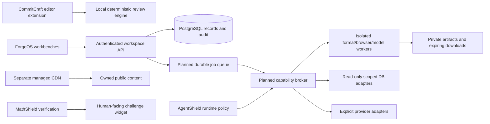

# ForgeOS delivery and architecture roadmap

Status: executable plan, not a completion certificate. Root AGENTS.md defines priorities. DESIGN.md defines component anatomy. Preserve current local login and workspace data while adding bounded vertical slices.

## Architecture

Only existing API/PostgreSQL/tool slices are operational today. Queue/broker/worker/artifact arrows describe the target. An extension stays useful offline and is not forced through a remote agent. New database and document workloads must not run arbitrary code in the API/web process.

## P0 - establish contracts and deliver CommitCraft extension

Deliver AGENTS/DESIGN, product catalog, security/action boundaries, an installable local VSIX, deterministic engine tests and host-boundary tests. Native Git integration reads explicitly selected staged changes. Preview -> edit -> fill SCM message only. Release artifacts must identify version, hash, source and supported/tested hosts. Marketplace/Open VSX publishing requires publisher identity and signing/distribution readiness; packaging is not publishing. Leo stays pending.

Exit: no implicit source uploads; no auto-commit/stage/push; stale diff detection; untrusted workspace denied; input budgets; no secret files in preview; VSIX inspected. Then run real-host installation/activation and multi-root checks separately for VS Code, Cursor, Windsurf and Kiro before claiming support. Add BYOK/local model assistance only with provider budgets, consent, SecretStorage and quality fixtures.

## P1 - StackForge and SnapDiff foundations

StackForge: bold code-first UI using existing deterministic engine; typed recipes and reproducibility manifest; validate generated projects in ephemeral isolated workers before presenting a validated badge. SnapDiff: bounded local comparison workbench; controlled browser baselines and worker capture come later. Detailed acceptance gates live in their specifications.

Exit: complete fixture runs for supported recipes, explicit generated/validated status, deterministic comparison fixtures, responsive/keyboard workflows and recorded performance measurements. Targets are not reported as measured gains.

## P2 - shared execution, audit, artifacts and connector boundary

Implement durable job states queued/running/canceling/canceled/passed/failed/expired, idempotency keys, per-tenant limits, timeout, revocation and artifact retention. Create read-only Postgres/MySQL/SQLite adapters first; then SQL Server/Mongo/Redis with typed projections. Store credentials in an approved secret service; UI sees references and masked metadata. Accessibility test reports network/TLS/auth/permission stages separately without writing business tables.

Exit: cross-workspace denial, connection-time SSRF/DNS protection, secret-redaction fixtures, restore tests, canceled-job cleanup and a real read-only comparison across representative datasets. Cloud provider branding does not create a separate SQL dialect or connector implementation.

## P3 - Comparer, prompt optimization and complete probes

Comparer: keyed row/cell/schema/archive/email/file adapters with explicit size and sample policies. PromptVault: attached source provenance and versioned prompts. ProbeAI: held-out evaluation and budgeted optimization. PulseWatch: authorized UI/API/DB probes with console/network evidence and configurable alert policy. Keep audit/session/run/probe logs separate and state their retention and gaps.

Exit: compare semantic differences rather than only serialized JSON; do not train/evaluate on the same holdout; promoted prompts must pass regression thresholds; browser screenshots are reproducible; console logs redact tokens and personal data.

## P4 - Converter and asset/resume completion

Start with image/text/PDF page operations and Office-to-PDF workers. Follow the explicit capability registry; then OCR, PDF reconstruction, annotation/forms and source-grounded AI. Finish GLB and CraftCV persistence/exports through the artifact layer. Formats need individual licenses, fixtures and fidelity checks; no 'all formats' badge.

## P5 - separate research products

AgentShield runtime containment is a security engineering program: threat model -> gateway/broker -> OS/VM isolation -> controlled adversarial fixtures -> external assessment -> bounded deployment. No universal escape-prevention or world-first claim without evidence. Managed CDN, MatchPlay and Crypto Vault remain separate specifications and release gates, never renamed versions of AgentShield drafts.

## Release evidence

Per slice: code/docs/help agree; format/engine/version registry; actual tests with IDs; current measured latency/memory/quality; unsupported cases; role/tenant checks; rollback/data compatibility; artifact hashes; dependency/license review. Screenshots/builds do not prove functional parity, security isolation or all-editor compatibility. Preserve original artifacts and user data during every migration.

Detailed AgentShield runtime threat model and enforcement gates: [AGENTSHIELD-RUNTIME.md](AGENTSHIELD-RUNTIME.md).
